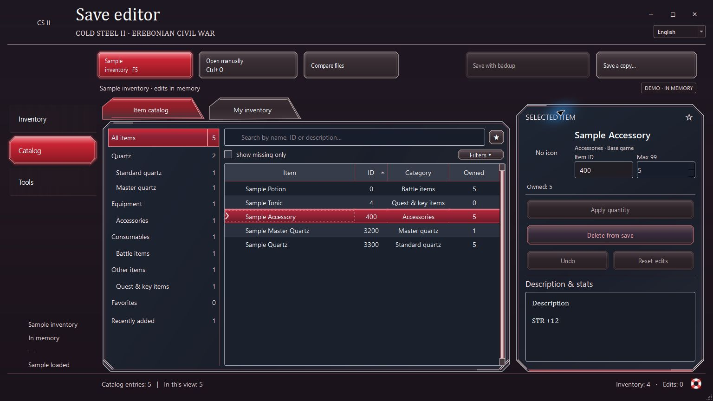

# Cold Steel II Save Editor

[](https://github.com/Sqzzzzzzz/Cold-Steel-II-Save-Editor/actions/workflows/windows.yml)
[](#requirements)
[](LICENSE)

An offline inventory editor for **The Legend of Heroes: Trails of Cold Steel II** on Steam. It reads item data from the installed game and changes only the active inventory in a verified PC save.



## Features

- Browse the catalog and inventory by category, item name, ID, description, ownership, and DLC source.
- Add, remove, or change quantities for individual items or selections. Review, undo, or reset edits before saving.
- View equipment stats, master quartz abilities, and read-only fishing and DLC references.
- Compare inventories, export a CSV, save a separate `.dat`, or overwrite a slot with a verified backup.
- Switch the interface between English and Russian.

## Requirements

- 64-bit Windows 10 or 11. The Windows package includes Python and Qt.
- The Steam PC installation with `data/text/dat_us/t_item.tbl`. The editor was verified against PC 1.4.1, Steam build `3518949`, and 493,976-byte version-8 saves.

## Download Latest Release

Download `Cold-Steel-II-Save-Editor-v1.0.0-Windows.zip` and `SHA256SUMS.txt` from the first release. [GitHub Releases](https://github.com/Sqzzzzzzz/Cold-Steel-II-Save-Editor/releases/latest)

## Installation

1. Compare the archive's SHA-256 with `SHA256SUMS.txt`. On Windows, run `Get-FileHash -Algorithm SHA256 -LiteralPath '<archive.zip>'`.
2. Extract the entire ZIP and run `Cold_Steel_II_Save_Editor.exe`. Keep `_internal` alongside it.
3. If Steam detection misses the installation, choose **Tools → Scan game folder** and select the folder containing `data`.

## How to Use

1. Open a compatible slot with **Latest Save** (F5) or **Open Manually** (Ctrl+O).
2. Select a catalog or inventory row, enter the quantity, and choose **Apply Quantity**. A quantity of zero removes the item. Ctrl and Shift select multiple rows. Apply a typed quantity before leaving the item.
3. Review the changes. Use **Save a Copy** (Ctrl+S) for a separate `.dat`, or **Save with Backup** to update the opened slot. Ctrl+Z undoes the last edit.
4. Use the category list, column headers, and **Filters** to narrow the catalog. In the catalog, batch actions can apply a quantity to selected rows. In the inventory, select rows to remove them together. **Tools → Compare saves** summarizes differences with another compatible slot.

## Save File Detection

The game stores its Steam PC saves in the Windows Saved Games folder under `Falcom\ed8_2` (normally `%USERPROFILE%\Saved Games\Falcom\ed8_2`). The editor first checks the last folder opened manually, then falls back to that location. Automatic selection considers manual slots `save000.dat` through `save199.dat` and autosaves. Open clear-data slots and `.bak` files manually. Steam libraries are searched separately for the game installation and item tables.

## Backup & Safety

Close the game before overwriting a slot. The editor verifies the original snapshot, writes a timestamped `.bak`, replaces the slot, and checks the resulting bytes. It preserves progression, equipped items, secondary inventory blocks, slot metadata, and thumbnails. The tested format has no separate inventory checksum.

To undo a write, open the edited slot and choose **Tools → Restore Backup**. Restore checks the slot's unchanged data and validates the inventory differences against the installed catalog. The editor backs up the current slot before restoring it. If a backup contains a DLC item absent from the current slot, open the original `.bak` and export it as a separate `.dat` to recover that snapshot.

## Troubleshooting

| Issue | What to check |
| --- | --- |
| Game or catalog missing | Choose the Steam installation that contains `data/text/dat_us/t_item.tbl`. |
| No compatible save found | Use Ctrl+O with the actual `.dat` slot. `sdslot.dat`, settings, thumbnails, and autosave sidecars are separate files. |
| Slot changed since opening | Reopen the slot or save a separate copy. Close the game before overwriting. |
| No item artwork | The portable build uses the built-in interface styling. For a local build, see [game artwork](docs/asset-provenance.md). |

## Known Limitations

- Only the tested Steam PC format is supported. A separate export does not register a new slot in the game.
- Service records are hidden. Quest items, recipes, Black Records, and equipped master quartz or ARCUS covers are protected. Editing DLC items requires their presence in the original slot.
- The portable build uses original English catalog text. Where a local Russian dictionary is available, untranslated fields fall back to the game's original text.
- The Windows EXE is unsigned. The themed build was tested in-game by loading an isolated copy and confirming **Tear Balm ×73** in the inventory and in game-generated autosaves.

## Build & Test

```powershell
python -m venv .venv
.venv\Scripts\python.exe -m pip install -r requirements-build.txt
.venv\Scripts\python.exe -m unittest discover -v
.venv\Scripts\python.exe build_preview.py --without-assets
.venv\Scripts\python.exe package_release.py --portable --tag v1.0.0
```

For a local themed build, supply the [local assets](docs/asset-provenance.md) and omit `--without-assets` and `--portable`. The packaging script extracts and runs the ZIP before writing its checksum. Pass `--save <path>` to exercise startup with a temporary copy of a real slot. The integration tests use the local Steam installation and copy genuine saves before writing.

## Credits & Disclaimer

Maintained by **Sqzzzzzzz**. The interface derives from the Cold Steel I Inventory Editor. This is an unofficial project and is unaffiliated with Nihon Falcom. *Trails of Cold Steel II* and its artwork belong to their respective rights holders. [MIT license](LICENSE) · [Third-party notices](third_party/README.md) · [Artwork provenance](docs/asset-provenance.md)
